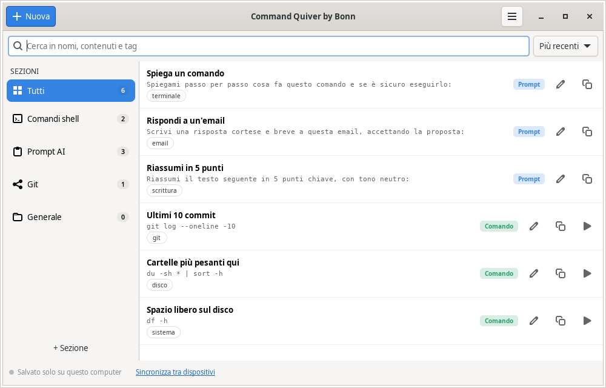
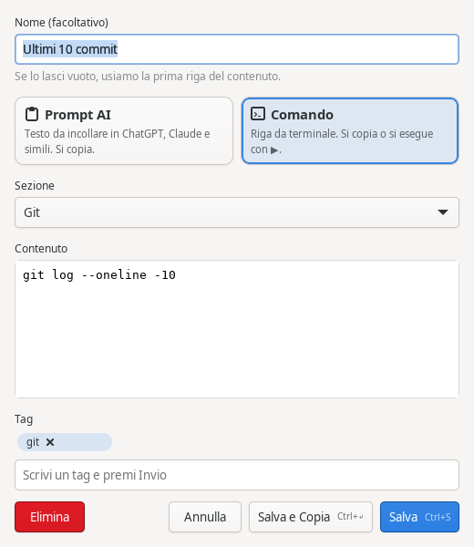
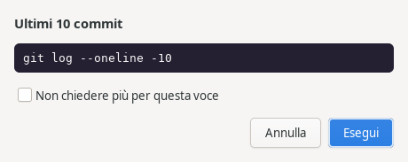
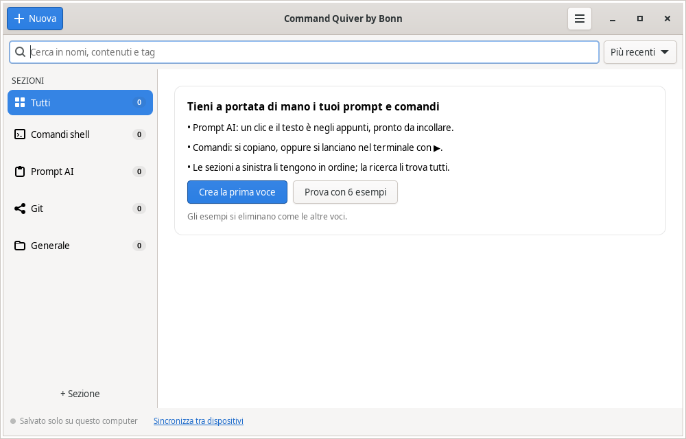
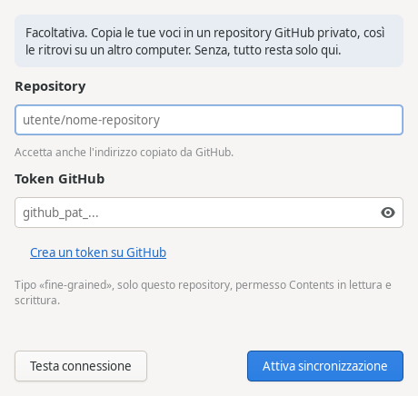
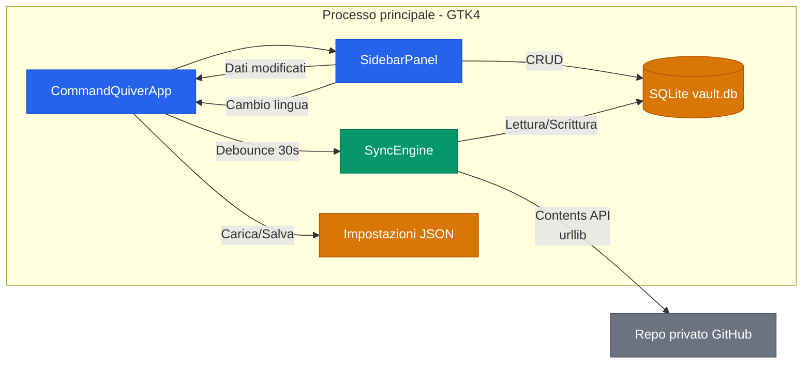
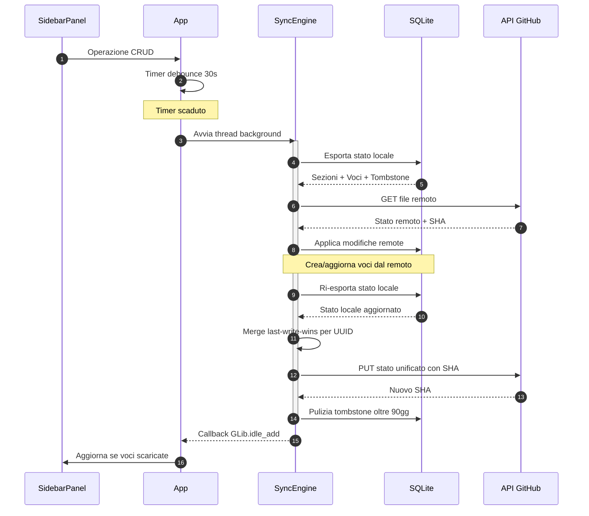

[English](README.md) | **Italiano**

# Command Quiver by Bonn

Libreria personale di prompt AI e comandi shell per il desktop GNOME. Cerca, organizza in sezioni, copia negli appunti o esegui nel terminale.

<div align="center">

[](https://github.com/AndreaBonn/command-quiver/actions/workflows/ci.yml)
[](https://github.com/AndreaBonn/command-quiver/actions/workflows/ci.yml)
[](https://github.com/AndreaBonn/command-quiver/actions/workflows/ci.yml)
[](https://docs.astral.sh/ruff/)
[](LICENSE)
[](SECURITY.md)

</div>

## Panoramica

Command Quiver by Bonn offre accesso rapido a prompt AI e comandi shell usati di frequente. Le voci sono salvate in un database SQLite locale, organizzate in sezioni e tag, e ricercabili per nome, contenuto e tag. Un click su una voce la copia negli appunti; i comandi shell si possono anche eseguire in gnome-terminal, dopo una conferma.

## Schermate



| Voce nuova o in modifica | Conferma di esecuzione |
|---|---|
|  |  |

| Primo avvio | Sincronizzazione GitHub |
|---|---|
|  |  |

## Architettura



> Per diagrammi tecnici dettagliati (schema database, macchine a stati, gerarchia componenti UI), vedi [docs/ARCHITECTURE.it.md](docs/ARCHITECTURE.it.md).

## Funzionalità

- Due tipi di voce: prompt AI (copiati negli appunti) e comandi shell (copiati, o eseguiti in gnome-terminal dopo una conferma che si può disattivare voce per voce)
- Ricerca su nomi, contenuti e tag, con sei ordinamenti: più recenti, meno recenti, nome A-Z, nome Z-A, personale, più usati
- Sezioni con il conteggio delle voci, e tag mostrati come etichette: un click su un tag filtra per quel tag
- Ordine personale con trascinamento o `Alt+↑/↓`
- L'eliminazione di una voce si può annullare per 5 secondi
- Schermata di benvenuto al primo avvio, con 6 voci di esempio da provare
- Import ed export dell'intera libreria in JSON
- Scorciatoie da tastiera (`Ctrl+?` le elenca)
- Interfaccia bilingue (italiano / inglese) con cambio lingua live
- Persistenza SQLite con WAL mode, backup automatici e recovery da corruzione
- Singola istanza garantita via D-Bus
- Impostazioni persistenti (ordinamento, dimensione finestra, lingua)
- Sincronizzazione tra dispositivi tramite repository privato GitHub, con lo stato sempre visibile nella barra in basso

## Sincronizzazione multi-dispositivo

Command Quiver permette di sincronizzare voci e sezioni tra piu computer usando un repository privato GitHub come storage. Non servono dipendenze esterne -- la sincronizzazione usa solo la libreria standard Python.

### Come funziona

- All'avvio, l'app scarica dal repository remoto e integra le nuove voci
- Dopo ogni modifica (creazione, modifica, cancellazione), l'app invia le modifiche al repository entro 30 secondi
- Alla chiusura, viene eseguita una sincronizzazione finale
- I conflitti si risolvono automaticamente: vince la modifica piu recente
- Le cancellazioni si propagano a tutti i dispositivi

### Flusso di sincronizzazione



### Configurazione

#### 1. Crea un repository privato su GitHub

1. Vai su [github.com/new](https://github.com/new)
2. Imposta **Repository name** su `command-quiver-sync` (o qualsiasi nome)
3. Imposta **Visibility** su **Private**
4. **Non** spuntare "Add a README" -- il repository deve essere vuoto
5. Clicca **Create repository**

#### 2. Crea un Personal Access Token

1. Vai su [github.com/settings/tokens?type=beta](https://github.com/settings/tokens?type=beta) (Fine-grained tokens)
2. Clicca **Generate new token**
3. Imposta **Token name** su `command-quiver-sync`
4. Imposta **Expiration** a piacere (1 anno consigliato)
5. In **Repository access**, seleziona **Only select repositories** e scegli il tuo repository di sync
6. In **Permissions > Repository permissions**, imposta **Contents** su **Read and write**
7. Clicca **Generate token**
8. Copia il token (inizia con `github_pat_...`) -- lo vedrai solo questa volta

#### 3. Configura in Command Quiver

1. Apri Command Quiver
2. Clicca **Sincronizza tra dispositivi** nella barra in basso, oppure apri il menu principale (☰) e scegli **Sincronizzazione…**
3. Compila i campi:
   - **Repository**: `tuo-username/command-quiver-sync`, oppure incolla l'indirizzo del repository copiato da GitHub
   - **Token GitHub**: incolla il token dal passo 2
4. Clicca **Testa connessione** per verificare. Se fallisce, il messaggio dice perché (token scaduto, permesso mancante, repository non trovato, rete assente)
5. Se la connessione riesce, clicca **Attiva sincronizzazione**

#### 4. Configura gli altri computer

Ripeti il passo 3 su ogni computer (usa lo stesso repository e token). Al primo avvio con sync attivo, l'app scarica tutte le voci dal repository e le integra con i dati locali.

### Percorsi dei dati di sync

| Percorso | Contenuto |
|---|---|
| `~/.config/command-quiver/settings.json` | Configurazione sync (repo, stato) |
| `~/.config/command-quiver/.sync_token` | Token GitHub (permessi file: 600) |

## Requisiti

- Python >= 3.10
- GTK4 e PyGObject
- gnome-terminal (per esecuzione comandi shell)
- pycairo (per generazione icona)

Su Ubuntu/Debian:

```bash
sudo apt install python3-gi python3-gi-cairo gir1.2-gtk-4.0 gnome-terminal
```

## Installazione

### Dal pacchetto .deb (consigliato, il più veloce)

È il modo più rapido per installare Command Quiver su Ubuntu/Debian.

1. Scarica l'ultimo `.deb` dalla [pagina delle release](https://github.com/AndreaBonn/command-quiver/releases/latest).
2. Installalo (apt risolve da solo le dipendenze di sistema):

```bash
sudo apt install ./command-quiver_*.deb
```

Dopo l'installazione, avvia l'app dal menu GNOME o con il comando `command-quiver` da terminale.

Per avviarla automaticamente all'accesso (e riavviarla in caso di crash):

```bash
systemctl --user enable --now command-quiver.service
```

Vedi [docs/PACKAGING.md](docs/PACKAGING.md) per i dettagli su build, systemd e disinstallazione.

### Da sorgente

```bash
git clone https://github.com/AndreaBonn/command-quiver.git
cd command-quiver
uv sync
```

## Utilizzo

Avvia l'applicazione:

```bash
uv run python command_quiver/main.py
```

La finestra principale si apre all'avvio. Chiudendola (pulsante di chiusura o `Ctrl+Q`) l'applicazione termina, eseguendo prima una sincronizzazione finale e salvando lo stato.

Nella finestra principale:

- Click su **Nuova** nella barra del titolo (o `Ctrl+N`) per creare un prompt o un comando shell. Il nome è facoltativo: se resta vuoto si usa la prima riga del contenuto
- Click su una voce per copiarla negli appunti. I comandi shell hanno anche il pulsante ▶, che li esegue nel terminale
- Scrivi nella barra di ricerca per filtrare per nome, contenuto e tag; `Invio` copia il primo risultato, `Esc` svuota la ricerca
- Scegli l'ordinamento dal menu a tendina accanto alla ricerca
- Gestisci le sezioni con **+ Sezione**; rinomina o elimina una sezione dal suo menu o con il click destro
- Apri il menu principale (☰) per lingua, sincronizzazione, import/export, scorciatoie e informazioni

### Scorciatoie da tastiera

| Scorciatoia | Azione |
|---|---|
| `Ctrl+F` | Vai alla ricerca |
| `Ctrl+N` | Nuova voce |
| `Invio` | Copia il primo risultato |
| `Esc` | Svuota la ricerca |
| `Alt+↑` / `Alt+↓` | Sposta la voce selezionata (ordine Personale) |
| `Ctrl+S` | Salva (nella finestra della voce) |
| `Ctrl+Invio` | Salva e copia (nella finestra della voce) |
| `Ctrl+?` | Mostra l'elenco delle scorciatoie |
| `Ctrl+Q` | Esci |

### Percorsi dei dati

| Percorso | Contenuto |
|---|---|
| `~/.local/share/command-quiver/vault.db` | Database SQLite |
| `~/.local/share/command-quiver/vault.auto.bak.*` | Backup automatici (ogni 5 avvii, restano gli ultimi 3) |
| `~/.config/command-quiver/settings.json` | Impostazioni utente |
| `~/.local/share/command-quiver/logs/` | Log applicazione |

## Test

```bash
uv run pytest
```

Con copertura:

```bash
uv run pytest --cov=command_quiver
```

Lint:

```bash
uv run ruff check .
```

## Contribuire

I contributi sono benvenuti. Apri una issue per discutere la modifica prima di inviare un pull request. Segui lo stile del codice esistente (configurazione ruff in `pyproject.toml`) e includi test per le nuove funzionalità.

## Sicurezza

Per segnalare vulnerabilità, consulta la [policy di sicurezza](SECURITY.it.md).

## Licenza

Rilasciato sotto licenza Apache 2.0 -- vedi [LICENSE](LICENSE).

## Autore

Andrea Bonacci -- [@AndreaBonn](https://github.com/AndreaBonn)

## Sostieni il progetto

Command Quiver è gratuita. Se ti è utile e vuoi contribuire, puoi lasciare un'offerta tramite PayPal. L'importo lo scegli tu ed è del tutto facoltativo.

<div align="center">

[](https://paypal.me/AndreaBonacci19)

</div>

---

Se questo progetto ti è utile, una stella su GitHub è apprezzata.
