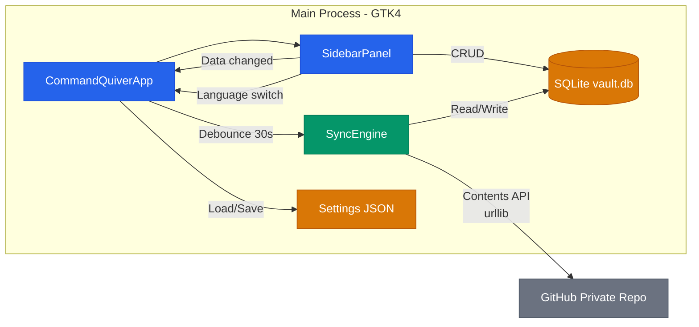
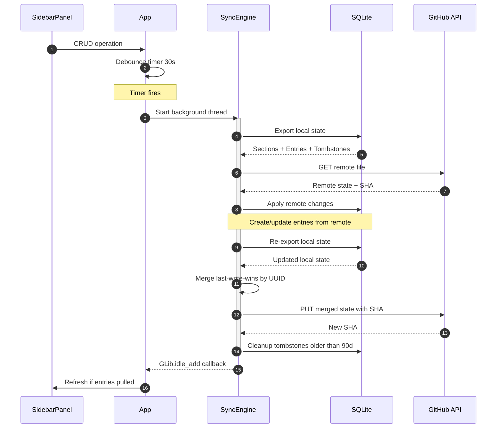
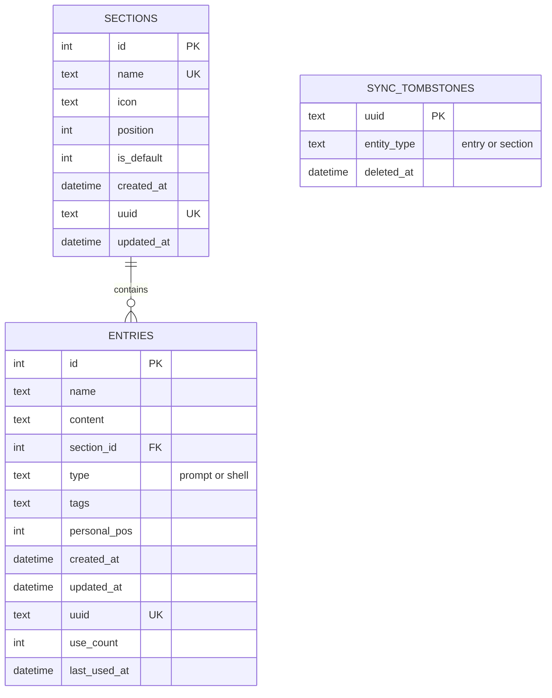
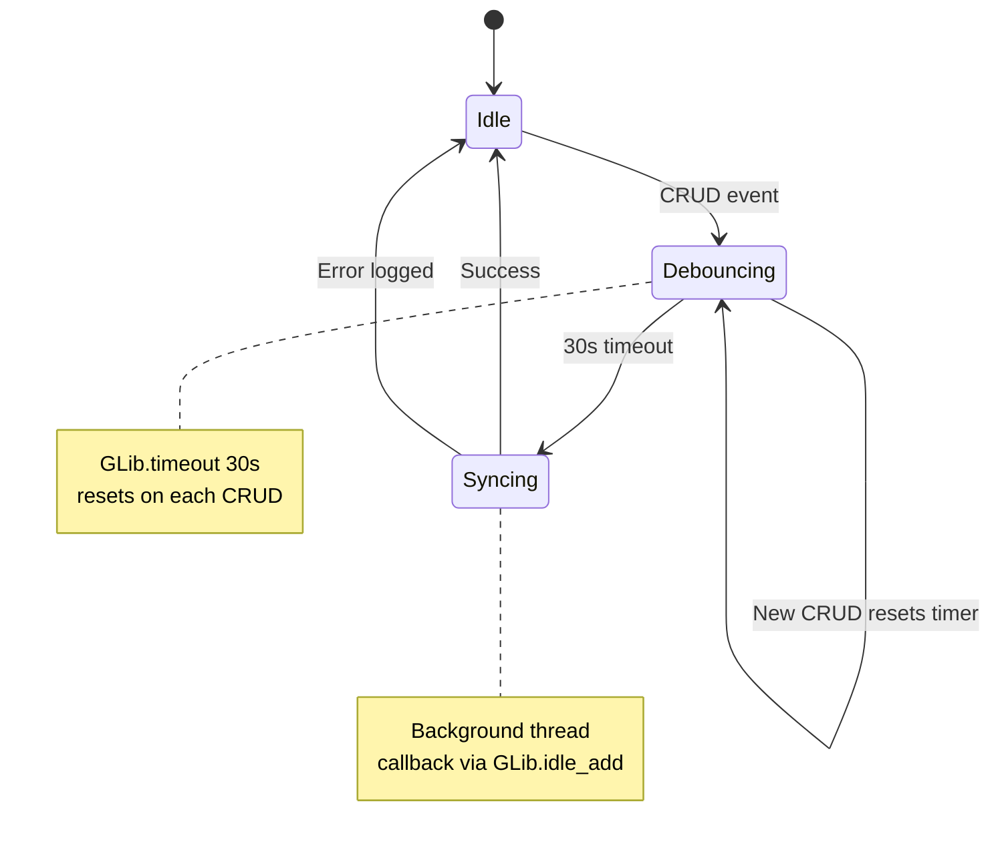
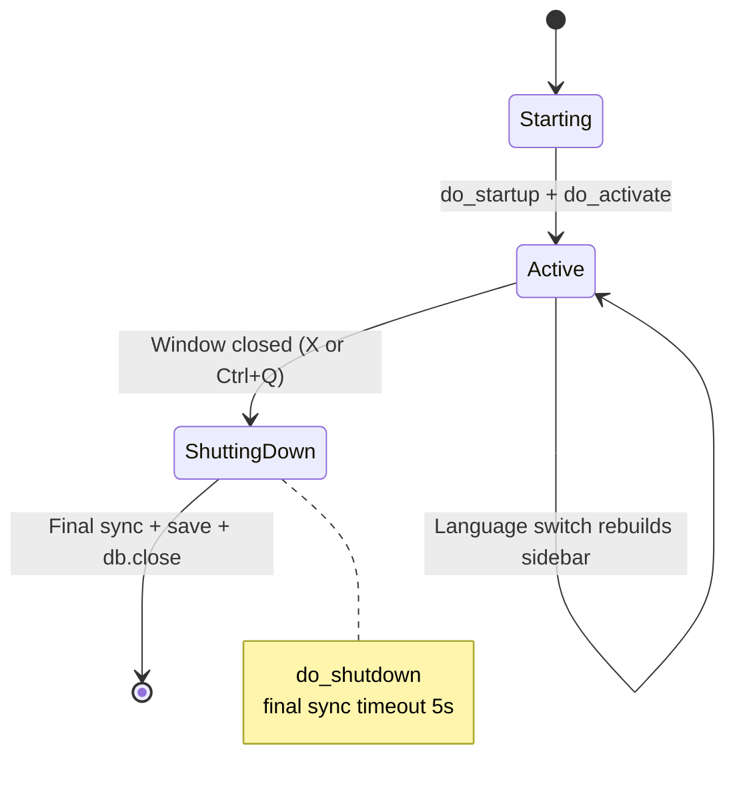

**English** | [Italiano](ARCHITECTURE.it.md)

# Technical Architecture

Developer reference with detailed diagrams of Command Quiver internals.

## System Architecture

GTK4 main process and GitHub sync via Contents API.

## Sync Flow

Cross-device sync sequence: CRUD triggers a 30s debounce, then export-pull-merge-push in a background thread.

## Database Schema

Three tables: sections and entries (with UUID for cross-device identity), plus tombstones for deletion propagation.

## State Machines

### Sync Debounce

CRUD events start a 30s debounce timer. Each new CRUD resets it. When the timer fires, sync runs in a background thread and returns via `GLib.idle_add`.

### Application Lifecycle

The main window is the application: closing it (close button or `Ctrl+Q`) runs a final sync, saves state, and quits via `do_shutdown`.

## UI Component Hierarchy

GTK4 widget tree of the main window. Dialogs are separate `Gtk.Window`s opened from the widgets that point to them.

```mermaid
%%{init: {'theme': 'default'}}%%
graph TD
  app["CommandQuiverApp<br/>Gtk.Application"]
  sidebar["SidebarPanel<br/>Gtk.Window"]
  header["HeaderBar"]
  new_entry["New btn<br/>&#8594; EntryEditorDialog"]
  menu["Main menu &#9776;<br/>language, sync, import/export,<br/>shortcuts, about, quit"]
  search_bar["SearchBar"]
  search["SearchEntry<br/>names, content, tags"]
  sort_dd["Sort DropDown<br/>6 options"]
  paned["Gtk.Paned"]
  section_panel["SectionPanelWidget"]
  section_row["SectionRow x N<br/>icon | name | count | menu"]
  new_section["+ Section btn<br/>&#8594; SectionNameDialog"]
  toast["ToastOverlay<br/>copied, deleted + Undo"]
  entry_list["EntryListWidget"]
  entry_row["EntryRow x N<br/>name | preview | tags | badge<br/>edit | copy | run"]
  empty["Empty state<br/>welcome, empty section, no results"]
  run_confirm["RunConfirmDialog"]
  status_bar["SyncStatusBar<br/>&#8594; SyncSetupDialog"]

  app --> sidebar
  sidebar --> header
  sidebar --> search_bar
  sidebar --> paned
  sidebar --> status_bar
  header --> new_entry
  header --> menu
  search_bar --> search
  search_bar --> sort_dd
  paned --> section_panel
  paned --> toast
  section_panel --> section_row
  section_panel --> new_section
  toast --> entry_list
  entry_list --> entry_row
  entry_list --> empty
  entry_row --> run_confirm

  classDef root fill:#1d4ed8,stroke:#1e40af,color:#fff
  classDef container fill:#2563eb,stroke:#1d4ed8,color:#fff
  classDef leaf fill:#bfdbfe,stroke:#3b82f6,color:#1e3a5f
  classDef action fill:#d97706,stroke:#b45309,color:#fff

  class app root
  class sidebar,header,search_bar,paned,section_panel,toast,entry_list container
  class search,sort_dd,section_row,entry_row,empty leaf
  class new_entry,menu,new_section,run_confirm,status_bar action
```

